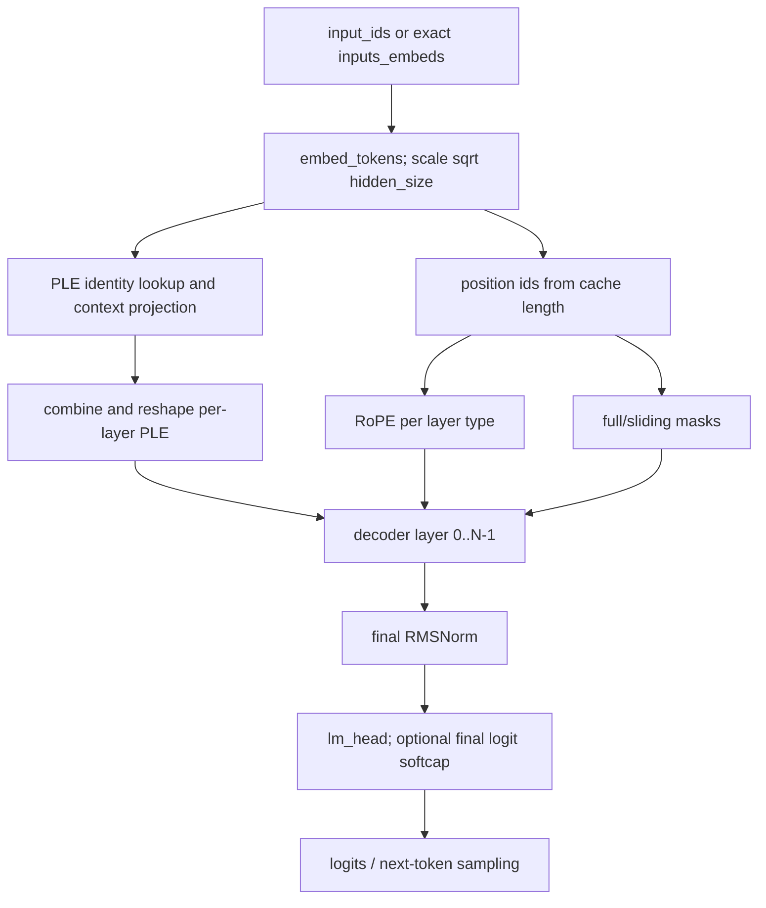

# Gemma 4 Hugging Face Architecture Reference

**Scope.** This is a source reference for the Hugging Face Gemma4 implementation in
`/ai-code/transformers`, with a text-only inference focus and a boundary description of
the multimodal path. It was written from the upstream implementation, upstream tests,
and the checked-in Deliverance implementation. It does not modify production code.

Source paths below are absolute so that a parity investigation can jump directly to the
relevant code. `modeling_gemma4.py` is generated from `modular_gemma4.py`; the modular
file is the conceptual source (`modeling_gemma4.py:1-6`).

## Executive Model

Gemma4 text is a decoder-only language model with:

- a scaled token embedding, final RMSNorm, and tied-by-default LM head;
- a per-layer input (PLE) stream in addition to the normal hidden stream;
- a repeating sliding/full attention layout;
- layer-type-specific head dimensions and RoPE;
- optional KV sharing for the final layers, keyed by attention type;
- a dense gated MLP, optionally combined with a sparse MoE branch;
- a learned scalar after each decoder layer.

Gemma4 is **not** Gemma3 with a renamed configuration. Gemma3 has one ordinary
`Gemma3Attention` projection layout and attention scale `query_pre_attn_scalar**-0.5`
(`gemma3/modeling_gemma3.py:300-324`), whereas Gemma4 sets attention `scaling = 1.0`
and adds PLE, heterogeneous per-layer dimensions, KV sharing, optional MoE, and a
layer scalar (`modeling_gemma4.py:1151-1176`, `:1344-1430`). Gemma3's bidirectional
option is a boolean and its mask overlay applies to its sliding/full mask construction
(`gemma3/configuration_gemma3.py:40-42,101-114`; `gemma3/modeling_gemma3.py:460-470,497-526`).
Gemma4 uses the string modes `None`, `"vision"`, and `"all"`, and explicitly keeps
full attention causal in the vision mask path (`modular_gemma4.py:83-143`).

## Configuration Classes

### `Gemma4TextConfig`

Defined at `configuration_gemma4.py:87-240`. Defaults include:

| Field | Default | Meaning |
|---|---:|---|
| `vocab_size` | 262144 | Main token vocabulary |
| `hidden_size` | 2304 | Main residual width |
| `intermediate_size` | 9216 | Dense MLP intermediate width |
| `num_hidden_layers` | 30 | Decoder depth |
| `num_attention_heads` / `num_key_value_heads` | 8 / 4 | Query and KV heads |
| `head_dim` | 256 | Default per-head width |
| `max_position_embeddings` | 131072 | Position limit |
| `sliding_window` | 512 | Local attention window |
| `hidden_activation` | `gelu_pytorch_tanh` | Dense and expert activation |
| `vocab_size_per_layer_input` | 262144 | PLE identity vocabulary |
| `hidden_size_per_layer_input` | 256 | PLE width per layer |
| `num_kv_shared_layers` | 0 | Number of final layers that reuse KV |
| `attention_k_eq_v` | `False` | Full-layer K-as-V alternative |
| `enable_moe_block` | `False` | Enable dense-plus-MoE branch |
| `use_double_wide_mlp` | `False` | Double dense MLP only on shared-KV layers |

Token IDs are `pad=0`, `eos=1`, `bos=2`; word embeddings are tied by default
(`configuration_gemma4.py:152-183`). `final_logit_softcapping` is optional and is
applied only by the causal LM head, not by text attention (`modeling_gemma4.py:1851-1857`).

`__post_init__` creates a five-sliding-to-one-full pattern (the full layer is every
sixth layer) when `layer_types` is absent, forces the last layer to `full_attention`,
and installs these RoPE defaults:

```text
sliding_attention: {rope_type: default,       rope_theta: 10_000}
full_attention:    {rope_type: proportional,  partial_rotary_factor: 0.25,
                    rope_theta: 1_000_000}
```

These facts are `configuration_gemma4.py:185-208`. With `use_bidirectional_attention
== "all"`, HF changes `is_causal=False` and internally stores
`sliding_window=(configured_window//2)+1`; serialization reverses that transformation
(`configuration_gemma4.py:185-188,227-234`). Full-layer overrides are inserted into
`per_layer_config` with `head_dim=global_head_dim` and, when `attention_k_eq_v` is true,
`num_key_value_heads=num_global_key_value_heads` (`configuration_gemma4.py:210-224`).

### `Gemma4VisionConfig` and `Gemma4AudioConfig`

`Gemma4VisionConfig` is at `configuration_gemma4.py:243-290`. Its default encoder is
16 layers, width 768, 12 heads of width 64, intermediate width 3072, patch size 16,
pooling kernel 3, and axial RoPE (`:270-290`). Vision uses bidirectional self-attention
on its patch sequence (`modeling_gemma4.py:1037-1057`).

`Gemma4AudioConfig` is at `configuration_gemma4.py:29-82`. Its defaults are width 1024,
12 layers, 8 heads, two subsampling channels `[128,32]`, conformer convolution kernel
5, attention chunks 12, left context 13, right context 0, attention logit cap 50,
and output projection width 1536 (`:55-76`). It is an eager-only chunked local audio
encoder (`modeling_gemma4.py:1890-1917`).

`Gemma4Config` is the multimodal wrapper at `configuration_gemma4.py:295-357`. It has
optional `vision_config` and `audio_config`, required `text_config` by default, and
modality IDs for image/video/audio plus begin/end delimiters (`:336-352`). The wrapper
constructs `vision_tower`, `language_model`, optional `audio_tower`, and the two
projectors (`modeling_gemma4.py:2162-2179`).

### Class Inventory: Encoder Side

The important encoder classes are distinct from the text decoder classes:

- `Gemma4AudioRelPositionalEncoding` creates a reversed sinusoidal `[1, context/2+1,
  hidden]` encoding (`modeling_gemma4.py:226-254`).
- `Gemma4AudioAttention` is chunked local attention with relative-position keys,
  Q/K scales, softcap, and blocked tensors (`:257-360`).
- `Gemma4AudioSubSampleConvProjectionLayer` and
  `Gemma4AudioSubSampleConvProjection` apply two stride-2 Conv2d stages and flatten
  the result into audio hidden states (`:363-418`).
- `Gemma4AudioFeedForward`, `Gemma4AudioCausalConv1d`, `Gemma4AudioLightConv1d`, and
  `Gemma4AudioLayer` make the conformer-style audio stack (`:421-583`).
- `Gemma4AudioModel` runs subsampling, relative positions, bidirectional/chunked audio
  layers, and the output projection (`:1890-1959`).
- `Gemma4VisionPatchEmbedder` patchifies and adds learned 2D position embeddings;
  `Gemma4VisionPooler` spatially pools soft tokens (`:585-696`).
- `Gemma4VisionMLP`, `Gemma4VisionRotaryEmbedding`, `Gemma4VisionAttention`,
  `Gemma4VisionEncoderLayer`, and `Gemma4VisionEncoder` implement the bidirectional
  vision transformer (`:697-1057`).
- `Gemma4MultimodalEmbedder` projects encoder outputs into text hidden size
  (`:2050-2110`); `Gemma4Model.get_image_features` and the wrapper forward perform
  placeholder replacement and scattering (`:2181-2205,2306-2429`).

These encoder classes are not used by `Gemma4ForCausalLM`; they are used by the
separate `Gemma4Model` multimodal wrapper.

## Text Classes And Data Flow

### `Gemma4TextModel`

Construction is `modeling_gemma4.py:1548-1604`:

1. `embed_tokens` has shape `[vocab_size, hidden_size]` and multiplies rows by
   `sqrt(hidden_size)` (`:1563-1566,1433-1444`).
2. `layers` contains `num_hidden_layers` `Gemma4TextDecoderLayer` instances.
3. `norm` is the final RMSNorm.
4. `rotary_emb` owns separate inverse-frequency buffers for each distinct layer type.
5. When PLE is enabled, `embed_tokens_per_layer` has shape
   `[vocab_size_per_layer_input, num_hidden_layers * hidden_size_per_layer_input]` and
   is scaled by `sqrt(hidden_size_per_layer_input)`; the context projection has shape
   `[hidden_size, num_layers * ple_dim]`, scale `hidden_size**-0.5`, and a PLE RMSNorm
   (`:1575-1593`).

The text forward contract requires exactly one of `input_ids` and `inputs_embeds`; token
IDs cannot be combined with an explicit `per_layer_inputs` (`:1609-1641`). If caching is
requested without a cache, it creates `DynamicCache(config=self.config)` (`:1642-1647`).
It computes positions from cached sequence length, makes full and sliding masks, makes
RoPE once per layer type, sends the layer-specific PLE slice to each decoder, and final
normalizes (`:1645-1698`).

### `Gemma4ForCausalLM`

`Gemma4ForCausalLM` wraps `Gemma4TextModel`, creates a bias-free `[hidden_size,vocab]`
LM head, and declares the head tied to `model.embed_tokens.weight`
(`modeling_gemma4.py:1782-1798`). Its forward delegates all text/cache/PLE arguments to
the text model, slices logits if requested, applies optional final tanh softcap, computes
optional loss, and returns logits plus cache/shared-KV/router outputs
(`:1800-1871`). The result shape is `[batch, selected_sequence, vocab_size]`.

### Prompt-to-logits



Prefill runs the whole prompt through every layer and populates non-shared cache
layers. Decode normally supplies one new token, `position_ids` starts at the cache's
seen length, and each non-shared layer appends its new K/V. HF `GenerationMixin` owns
the outer token loop; the model forward's explicit behavior is the delegation and
cache handling cited above. The upstream tests exercise cached-vs-cold generation and
generation beyond the sliding window (`tests/models/gemma4/test_modeling_gemma4.py:937-1047`).

## PLE: Exact Shapes, Scales, And Order

For `B` batch, `S` sequence, `L` layers, `P=hidden_size_per_layer_input`:

```text
main = embed_tokens(input_ids)                         [B,S,H]
identity_packed = embed_tokens_per_layer(input_ids)    [B,S,L*P]
identity = reshape(identity_packed)                    [B,S,L,P]
projected_packed = Linear(main) * H^(-1/2)              [B,S,L*P]
projected = reshape(projected_packed)                  [B,S,L,P]
projected = RMSNorm(projected)                         [B,S,L,P]
per_layer_inputs = (identity + projected) * 2^(-1/2)  [B,S,L,P]
```

`get_per_layer_inputs` and its packed reshape are `modeling_gemma4.py:1700-1744`;
projection, scale, norm, and combination are `:1746-1779`. If identity is unavailable,
HF returns projection alone (`:1776-1779`). For `inputs_embeds` without IDs, HF tries
to recover IDs by exact equality against the main embedding table (`:1719-1738`); this
is not a general arbitrary-embedding path. The upstream test deliberately skips random
`inputs_embeds` generation for this reason (`tests/models/gemma4/test_modeling_gemma4.py:131-135,312-314`).

At decoder layer `i`, the selected `per_layer_inputs[:,:,i,:]` is used only after the
attention and feed-forward residuals:

```text
ple_residual = hidden
ple = Linear_PLE( GELU(Linear_gate(hidden)) * per_layer_input )
ple = RMSNorm(ple)
hidden = ple_residual + ple
hidden = hidden * layer_scalar
```

That is `modeling_gemma4.py:1420-1430`. The PLE construction diagram is therefore:

```text
token IDs --lookup [B,S,L*P]--reshape--> identity [B,S,L,P] --+
                                                               +--> * 1/sqrt(2)
main embeddings [B,S,H] --Linear, *1/sqrt(H), reshape, RMSNorm--+
                                                               |
                                             layer i slice [B,S,P]
                                                               |
                 decoder output --gate--> GELU --multiply--> project -> RMSNorm -> residual
```

## Decoder Layer Ordering

For each layer, the verified order is:

```text
residual = hidden
hidden = input_layernorm(hidden)
hidden = self_attn(hidden, layer-type mask, layer-type RoPE, cache)
hidden = post_attention_layernorm(hidden)
hidden = residual + hidden

residual = hidden
hidden = pre_feedforward_layernorm(hidden)
hidden = dense_mlp(hidden)

if MoE:
    dense_branch = post_feedforward_layernorm_1(hidden)
    moe_input = pre_feedforward_layernorm_2(residual)
    moe_branch = experts(moe_input, router(residual))
    moe_branch = post_feedforward_layernorm_2(moe_branch)
    hidden = dense_branch + moe_branch

hidden = post_feedforward_layernorm(hidden)
hidden = residual + hidden
hidden = PLE residual branch, if enabled
hidden = hidden * layer_scalar
```

The exact implementation is `modeling_gemma4.py:1384-1430`; the layer scalar is a
one-element buffer initialized to one (`:1352-1356,1498-1499`). This is similar to
Gemma3's pre/post attention and FF norms (`gemma3/modeling_gemma3.py:375-418`), but
Gemma4 adds MoE, PLE, and scalar operations after the otherwise similar residual flow.

## Attention, Dimensions, RoPE, And Masks

`Gemma4TextAttention` is at `modeling_gemma4.py:1151-1264`.

For layer `i`, `layer_config = config.per_layer_config[i]` supplies `head_dim` and
`num_key_value_heads` (`:1162-1166`). Query projection is
`[H, num_attention_heads * head_dim_i]`; K/V projections are
`[H, num_key_value_heads_i * head_dim_i]`; output projection is
`[num_attention_heads * head_dim_i, H]` (`:1178-1201`). Thus full layers may use
`global_head_dim=512` while sliding layers use `head_dim=256`. GQA repeats KV heads
with `num_attention_heads // num_key_value_heads_i`; this ratio must be integral.

The per-token attention sequence is:

```text
Q = q_proj(hidden).view(B,S,Q_heads,head_dim_i)
Q = q_norm(Q)
Q = RoPE(Q, cos_i, sin_i)
Q = transpose -> [B,Q_heads,S,head_dim_i]

K = k_proj(hidden).view(B,S,KV_heads_i,head_dim_i)
K = k_norm(K); K = RoPE(K, cos_i, sin_i); transpose
V = v_proj(hidden).view(...); V = v_norm(V); transpose
```

Q/K use learned RMSNorm scales; V uses RMSNorm without a scale
(`:1181-1186,1217-1239`). Text attention scaling is exactly `1.0` (`:1165-1167`),
not Gemma3's `1/sqrt(256)` default. The eager attention interface then performs the
masked QK product, softmax, value product, and output projection (`:1246-1264`).

When `attention_k_eq_v=True` on a non-sliding layer, `v_proj=None` and V initially
aliases the K projection (`:1164,1191-1197,1230-1233`). This is distinct from KV
sharing and must not be silently treated as a missing weight error.

RoPE is computed independently for every distinct layer type. The inverse frequency
depends on the resolved per-layer head width (`:1079-1109`), and forward computes
`position_ids[...,None] * inv_freq`, concatenates frequencies with themselves, then
returns cosine/sine in the input dtype (`:1137-1148`). Full proportional RoPE always
returns the full head-width encoding: it computes `int(partial_rotary_factor *
head_dim // 2)` rotating pairs and zero-fills the remainder, which produces identity
rotation there (`/ai-code/transformers/src/transformers/modeling_rope_utils.py:193-266`).
The Gemma4 full-layer default is a 0.25 proportion (`configuration_gemma4.py:203-208`).

### Masks

For ordinary text, `Gemma4TextModel.forward` constructs one `full_attention` causal
mask and one `sliding_attention` causal mask (`modeling_gemma4.py:1651-1664`). A local
layer sees causal tokens inside the configured window; a full layer sees all prior
tokens. `sliding_window_mask_function` documents the directional distance rule
(`modeling_gemma4.py:1874-1887`).

For multimodal `use_bidirectional_attention="vision"`, the wrapper creates block IDs
for contiguous image/video runs (`modeling_gemma4.py:2140-2149`) and uses:

```text
full mask    = causal only
sliding mask = sliding_window AND (causal OR same-vision-block)
```

This is explicit in `modular_gemma4.py:91-98,107-143`. With `"all"`, the text
configuration is non-causal (`configuration_gemma4.py:185-188`), and the upstream test
checks that every layer can attend to both directions (`test_modeling_gemma4.py:162-175`).
This full-layer behavior is a Gemma4 distinction: Gemma3's vision mask construction
adds bidirectional behavior through its shared mask kwargs (`gemma3/modeling_gemma3.py:495-518`).

## DynamicCache And Shared KV

`DynamicCache(config=text_config)` reads `config.per_layer_config`, removes the final
`num_kv_shared_layers` entries from the cache layer list, and instantiates a dynamic
full or sliding cache layer for each remaining type (`cache_utils.py:1871-1912,
1915-2003`). Dynamic cache tensors are `[B, heads, seq_len, head_dim]`; sliding cache
storage is bounded by the window (`cache_utils.py:1915-1934`). `Cache.update` dispatches
by the supplied `layer_idx`, lazily extending layers only when needed
(`cache_utils.py:1505-1540`).

Gemma4 additionally maintains `shared_kv_states: dict[str, (K,V)]`. Let
`first_shared = L - num_kv_shared_layers`:

- A layer `i >= first_shared` is a shared consumer.
- The consumer reads `shared_kv_states[layer_type]`, not its own DynamicCache entry.
- Each non-shared layer computes K/V and calls `past_key_values.update(..., i)`.
- The last non-shared occurrence of each layer type stores its **full-length** updated
  K/V under that type before attention.
- A shared layer has no K/V projection or K/V norm modules.

The authoritative code is `modeling_gemma4.py:1171-1176,1183-1186,1222-1244`.
The reason for the separate map is important: a sliding cache can discard old rows,
but the shared consumer still needs the source layer's full sequence
(`:1222-1224`). The output dataclasses expose this map only when requested
(`:148-167,1694-1698`).

Example for `layer_types=[sliding,full,sliding,full]`, `L=4`, shared count 2:

```text
layer 0 sliding: own cache update; store shared_kv_states["sliding_attention"]
layer 1 full:    own cache update; store shared_kv_states["full_attention"]
layer 2 sliding: read shared_kv_states["sliding_attention"]
layer 3 full:    read shared_kv_states["full_attention"]
```

The general rule is “last non-shared occurrence of each type”, not “layer immediately
before the shared suffix”. A configuration with a shared type lacking a source is an
invalid runtime arrangement for this implementation; the attention code indexes the
map and does not synthesize a source (`:1225-1229`).

```text
Q(layer i) -> q_norm -> RoPE ------------------------------+
                                                          QK -> mask -> softmax -> V -> o_proj
source K/V -> k/v norm -> RoPE -> DynamicCache.update ---+
                 \
                  +--> shared_kv_states[type] -> all shared consumers of type
```

## Dense MLP And MoE

Dense `Gemma4TextMLP` uses two projections of width `I` and
`down_proj(GELU(gate_proj(x)) * up_proj(x))` (`modeling_gemma4.py:1060-1076`). If
`use_double_wide_mlp` is enabled, only a KV-shared layer doubles `I`
(`:1063-1071`).

The MoE router first unscaled RMS-normalizes, multiplies by learned `scale` and
`hidden_size**-0.5`, then projects to `[B*S,E]`; softmax is fp32. It selects top `K`,
renormalizes the selected probabilities to sum to one, and multiplies them by learned
per-expert scales (`modeling_gemma4.py:1307-1341`). Router output when requested is
`[B*S,E]` as documented in the output dataclasses (`:90-95`).

Expert weights are packed as:

```text
gate_up_proj: [E, 2*M, H]
down_proj:    [E, H, M]
top_k_index:  [B*S,K]
top_k_weight: [B*S,K]
```

Each selected expert computes `down(act(gate) * up)` and index-adds the weighted result
into `[B*S,H]` (`modeling_gemma4.py:1267-1304`). The decoder combines dense and MoE
branches using three additional RMSNorms before the final post-feedforward norm
(`:1403-1418`). Deliverance's corresponding routing and packed shapes are visible in
`core/src/main/java/io/teknek/deliverance/model/gemma4/Gemma4MoeFeedForward2.java:49-71,89-130`;
its router implementation is a comparison, not an upstream authority.

## Multimodal Boundary For Text-Only Inference

Text-only `Gemma4ForCausalLM` uses `Gemma4TextModel` directly and never constructs the
vision/audio towers. The multimodal wrapper instead:

1. identifies image/video/audio placeholder IDs (`modeling_gemma4.py:2208-2251`);
2. replaces OOV placeholder IDs with PAD before main embedding (`:2306-2315`);
3. derives PLE identity from the PAD-substituted hard-token stream (`:2316-2320`);
4. runs image/video/audio encoders and masked-scatter soft features into embedding slots
   (`:2322-2389`); and
5. selects vision block masks only when mode is `"vision"` and `mm_token_type_ids` is
   supplied; otherwise it uses generation masks (`:2397-2429`).

Vision patchification creates `[num_patches, patch_size*patch_size*channels]` and pads
position IDs with `(-1,-1)` (`image_processing_gemma4.py:87-116,243-259`). Audio is
mel-extracted, then two stride-2 convolutional subsampling layers reduce the time mask;
the processor inserts begin/audio-soft/end placeholders based on the resulting valid
count (`feature_extraction_gemma4.py:169-224`; `processing_gemma4.py:241-252`). These
are outside text-only generation and are not evidence that Deliverance's text path
supports multimodal inference.

## Tokenizer, Chat Template, BOS

Verified HF facts:

- Text config defaults `bos_token_id=2`, `pad_token_id=0`, `eos_token_id=1`
  (`configuration_gemma4.py:152-167`).
- The conversion script constructs the SentencePiece-derived tokenizer with
  `add_bos_token=False` and left padding (`convert_gemma4_weights.py:2559-2566`).
- That tokenizer registers Gemma turn/channel/tool tokens, including `<|turn>`,
  `<turn|>`, `<|channel>`, `<channel|>`, and `<|think|>` (`:2566-2586`).
- Generation config can stop on EOS, end-of-turn, and tool-response tokens when the
  chat template is included (`convert_gemma4_weights.py:2647-2653`).
- The upstream processor test's fixture template explicitly emits `{{ bos_token }}`,
  alternates `user` and `assistant` (rendered as `model`), wraps turns with
  `<start_of_turn>`/`<end_of_turn>`, and adds `<start_of_turn>model` for generation
  (`tests/models/gemma4/test_processing_gemma4.py:119-123`).

The test fixture uses a synthetic tokenizer and special names `<start_of_image>`,
`<end_of_image>`, `<audio_soft_token>`, etc. (`:73-88`); those names should not be
substituted for the conversion script's actual tokenizer aliases without checking the
checkpoint's tokenizer files. The repository does not contain the downloaded production
checkpoint's `chat_template.jinja`, only converter references to a remote template
(`convert_gemma4_weights.py:71-74,2551-2553`). Therefore the exact production rendered
string is an **open question** unless the local model directory is inspected.

Deliverance comparison: its support document correctly says the Grace tokenizer path is
the intended Gemma4 runtime path and calls out `<|turn>`/`<turn|>`
(`core/gemma4_support.md:74-85`). The local tokenizer behavior test verifies pad ID 0
and a cached tokenizer fixture, but does not verify BOS or chat rendering
(`grace/src/test/java/HfGemma4TokenizerBehaviorTest.java:6-24`).

## Prompt, Prefill, Decode Diagram

```text
render chat template
    -> tokenize (BOS/template/special IDs are part of the prompt)
    -> prefill all prompt positions
       -> embedding + PLE
       -> each layer: read/write cache, attention, MLP/MoE, PLE, scalar
       -> final norm + logits
    -> choose next ID
    -> decode loop:
       one ID + position = cached length
       -> same layer order
       -> non-shared K/V append; shared K/V read by type
       -> logits -> stopping/sampling
```

The HF model itself does not define Deliverance's sampling policy. Deliverance's
prefill/decode entry points are `Gemma4Model.batchForwardRef` and `forwardRef`
(`core/src/main/java/io/teknek/deliverance/model/gemma4/Gemma4Model.java:135-177`),
while its legacy paths are `batchForward`/`forward` (`:481-539`).

## Deliverance Versus HF

| Area | HF verified behavior | Current Deliverance behavior | Status / risk |
|---|---|---|---|
| Main embedding | Scale by `sqrt(H)` (`modeling_gemma4.py:1563-1566`) | Same scale, bfloat16-rounded (`Gemma4Model.java:287-321`) | Approximate dtype behavior; verify numerically |
| PLE | Packed `[Vple,L*P]`, projection scale `H^-1/2`, RMSNorm, combine `2^-1/2` | Explicit packed/split/combine support (`Gemma4PleSupport.java:15-49`; `Gemma4Model.java:495-505`) | High-level match; shape/dtype parity still needs golden tensors |
| Layer order | Norm-attention-norm-residual, dense/MoE, PLE, scalar (`modeling_gemma4.py:1384-1430`) | Same intended order (`Gemma4TransformerBlock.java:102-164`) | Compare residual multiplier behavior; Deliverance has generic multiplier hooks |
| Head dimensions | Per-layer `per_layer_config`; full and sliding can differ (`modeling_gemma4.py:1162-1201`) | Explicit layer head/KV length helpers (`Gemma4Config.java:122-151`) | Match for represented configs |
| Q/K/V norms | Q/K learned RMSNorm, V unscaled RMSNorm; shared layers omit KV modules | Same broad path (`Gemma4CausalSelfAttention.java:113-139`) | `attention_k_eq_v` needs variant coverage |
| Text attention scale | Exactly `1.0` (`modeling_gemma4.py:1165-1167`) | Unscaled dot product (`Gemma4CausalSelfAttention.java:207-226`) | Match |
| RoPE | Separate buffers and init per layer type (`modeling_gemma4.py:1079-1148`) | Precomputed per-type frequencies (`Gemma4Config.java:82-95,153-177`) | Candidate numerical mismatch: proportional formula must be probed |
| Text masks | Full causal; sliding causal-window (`modeling_gemma4.py:1651-1664`) | Procedural visible rows/window (`Gemma4CausalSelfAttention.java:146-205`) | Equivalent only for plain unpadded causal text; padding/bidirectional/multimodal differ |
| Vision masks | Full causal; sliding `window AND (causal OR blockwise)` (`modular_gemma4.py:91-143`) | No text-only evidence of multimodal mask support | Not implemented at this boundary |
| KV cache | DynamicCache has per-layer full/sliding storage; shared consumers use type map (`cache_utils.py:1871-2003`; `modeling_gemma4.py:1222-1244`) | `KvBufferCache` plus shared map (`Gemma4Model.java:41-68`; `Gemma4CausalSelfAttention.java:168-277`) | Conceptual match; different cache API and ownership |
| KV source mapping | Last non-shared layer of each type stores full K/V | `getSharedKvSourceLayer` / `storesSharedKvState` (`Gemma4Config.java:189-212`) | Match for valid patterns; test missing-source validation |
| MoE | fp32 softmax, top-k renorm, per-expert scale, packed `[E,2M,H]`/`[E,H,M]` | Implemented in V2 path (`Gemma4MoeFeedForward2.java:49-130`) | HF parity still explicitly listed as remaining work (`gemma4_hf_text_test_coverage.md:93-97`) |
| `attention_k_eq_v` | Full-layer `v_proj=None`, V aliases K projection (`modeling_gemma4.py:1164,1191-1197`) | Loader omits V weight (`Gemma4Model.java:383-395`) | Needs direct numerical test; legacy path may differ |
| Final logits | Tied head by default, optional final softcap (`modeling_gemma4.py:1782-1798,1851-1857`) | Output norm/head loaded (`Gemma4Model.java:263-273,347-368`) | Sampling boundary differs; compare logits before sampler |
| Tokenizer/chat | Converter says no automatic BOS; config BOS=2; exact production template remote | Grace is intended runtime path; local test only checks pad/sample IDs | Exact production template/BOS interaction is open until checkpoint files are inspected |

## Implementation Invariants Checklist

- [ ] `input_ids` XOR `inputs_embeds`; do not silently accept both
  (`modeling_gemma4.py:1628-1633`).
- [ ] Main embeddings are multiplied by `sqrt(hidden_size)`.
- [ ] PLE identity table is packed as `[Vple, L*P]`, then reshaped `[B,S,L,P]`.
- [ ] PLE context projection uses `hidden_size**-0.5`; projected PLE is RMS-normalized.
- [ ] Identity plus projected PLE is multiplied by `1/sqrt(2)`.
- [ ] Decoder receives only its own PLE slice, after attention and FF residuals.
- [ ] Layer scalar is applied last in every decoder layer.
- [ ] Attention scale is `1.0`, not Gemma3's query-pre-attention scale.
- [ ] Q and K have learned RMSNorm; V has unscaled RMSNorm.
- [ ] Q/K RoPE uses the layer type's head width and frequency table.
- [ ] Full and sliding layers use their own `head_dim`, KV-head count, and mask.
- [ ] GQA grouping is `num_attention_heads // layer_num_key_value_heads`.
- [ ] Full layers remain causal in the `"vision"` multimodal mask path.
- [ ] Sliding multimodal mask is `AND(window, OR(causal, blockwise))`.
- [ ] DynamicCache has no cache entries for the shared suffix layers.
- [ ] Shared consumers read the type-keyed full K/V map, not a truncated sliding cache.
- [ ] Shared source selection is by last non-shared occurrence of the same layer type.
- [ ] MoE router normalizes in fp32, top-k renormalizes, then applies expert scales.
- [ ] MoE router scores are `[B*S,E]`; expert weights are `[E,2M,H]` and `[E,H,M]`.
- [ ] Final logit softcap, when configured, is after the LM head only.
- [ ] Chat/tokenizer parity must be checked on exact IDs, including BOS/template tokens.

## Verified Facts Versus Open Questions

**Verified:** all architecture, shape, scale, layer-order, mask, and cache statements
above that cite HF source lines; the skipped upstream random-embedding test; the four-layer
shared-KV/MoE test configuration (`test_modeling_gemma4.py:74-109`); and Deliverance's
corresponding classes and support docs cited in the comparison.

**Open or not proven by these repositories:** exact production checkpoint chat-template
rendering; numerical equality of Deliverance proportional RoPE; numerical MoE parity;
multimodal generation parity in Deliverance; and whether every arbitrary `inputs_embeds`
case can be reversed exactly enough for PLE. Do not convert these into implementation
requirements without a checkpoint fixture or a focused cross-runtime tensor comparison.
